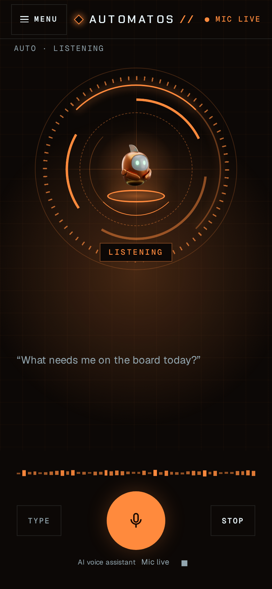

# Voice Chat

You can talk to Auto instead of typing, in two ways:

| | What it is | Where you find it | Who has it |
| --- | --- | --- | --- |
| **Hold to talk** | A quick spoken question. Hold the voice button, speak, let go, and hear Auto's answer. | The microphone button next to **Send** in Studio's chat, and in the chat of a theme such as Play or HUD. | Every plan, and the local edition. |
| **Auto Live** | A real-time voice call with Auto. You talk back and forth without holding anything. | The **Live** button in Studio's chat. In Play and HUD, the voice button starts a call when Auto Live is available. | Hosted edition: the Business plan. Local edition: once it is set up. See [Who has Auto Live](#who-has-auto-live). |

Either way, what you say and what Auto answers land in the same conversation as your typed messages. You can switch between talking and typing at any time.

## Hold to talk

### In Studio

1. Open **Chat**.
2. Press and hold the microphone button next to **Send**. If your browser asks for the microphone, allow it.
3. Speak. Your words show as they are heard.
4. Let go. Your words go to Auto as a message in this conversation.
5. Auto's answer appears in the chat as usual, and your browser reads it aloud.

Listening stops by itself after one minute, as if you had let go.

### In Play and HUD

Play and HUD have the same voice button in their own chat:

- **Play** puts it next to **Send** in the message box.
- **HUD** puts it in the middle of the sound wave above the message box. On a phone it is the large **Hold to talk** button between **Type** and **Stop**.
- On a laptop or desktop you can also hold the **Space** bar to talk, from anywhere on the page except a box you type in.
- Where your workspace has [Auto Live](#auto-live), the button starts a live call instead: press it once to start the call, and again to end it.



<figure><figcaption>
Play, Auto speaking. The caption "AI voice assistant" and the Stop button show under the voice button.
</figcaption></figure>



<figure><figcaption>
HUD, Auto listening. Your words show as they are heard.
</figcaption></figure>



<figure><figcaption>
HUD in a phone's browser, Auto listening.
</figcaption></figure>



### Stopping

- Click **Stop**, the square button next to the "AI voice assistant" caption.
- Or, while you hold the button, say only **"Auto, stop"** ("stop" and "cancel" work too). Nothing is sent. A longer sentence such as "stop the deploy" is a request, so it goes to Auto as you said it.
- Holding the button again while Auto is speaking stops Auto and listens to you again.
- If you switch to another tab, voice stops: the microphone closes and Auto stops speaking. An answer already on its way still lands in the chat.

### With a keyboard or a screen reader

- The voice button is an ordinary button. Press it with **Space** or **Enter**, or activate it with your screen reader, to start listening. Press it again to send what you said.
- Your screen reader hears what is happening: "Auto is listening", "Auto is thinking…", "Auto is speaking", and "Mic live" while the microphone is open.

### What you hear

- Your browser's own voice reads the answer, sentence by sentence. Your browser's language is used to hear you and to speak.
- Auto knows the answer will be heard, so it answers in short spoken sentences. When an answer holds code or a table, the voice says "There's code in the chat." or "There's a table in the chat.", and the chat shows the real thing.

### When hold to talk doesn't work

When something stops voice, the reason shows under the button, with **Try again** and **Close**. You can always type instead.

| You see | What to do |
| --- | --- |
| This browser can't recognise speech, so voice isn't available here. You can type to Auto instead. | Your browser has no speech recognition (Firefox, for example). Type, or use another browser. |
| Automatos can't hear you: the microphone is blocked for this site. Allow it in your browser's site settings, then try again. | Allow the microphone for Automatos in your browser's settings. |
| No microphone was found. Connect one, then hold to talk again. | Connect a microphone. |
| Nothing was heard. Hold to talk and try again. | Hold the button while you speak, and let go when you finish. |
| Speech recognition is turned off for this browser. Turn on dictation in your device's settings, or type to Auto instead. | Turn on dictation in your device's settings. |
| Speech recognition couldn't connect. Check your connection and try again. | Check your internet connection. |
| Auto can't be reached. Check your connection and try again. | Check your internet connection. |

## Auto Live

Auto Live is a real-time voice call with Auto. You don't hold anything: talk, listen, and talk again.

### Start and end a call

1. Open **Chat** and click **Live**, in the row of buttons with **Code**, **Plan** and **Mission**. If your browser asks for the microphone, allow it.
2. Talk to Auto. What you both say is written into the conversation on screen. With no conversation open, the call goes to your voice-call conversation.
3. While the call runs, a strip above the message box shows its state and time, **Mic live**, a mute button, a choice of microphone and the end-call button.
4. Click the end-call button, or **Live** again, to end the call.

In Play and HUD, the voice button starts the call when Auto Live is available. Press it again to end the call.

### Who has Auto Live

**Hosted edition.** Auto Live comes with the Business plan. The workspace's own Auto Live switch must also be on, and each workspace has a monthly allowance of Live minutes. On other plans, the **Live** button stays, and it tells you why Live can't start. Hold to talk works on every plan.

**Local edition (self-hosted).** There is no plan limit, but Auto Live is off until the person who runs the server sets it up. It needs:

- **A Retell account.** Auto Live's call runs through Retell. Its three credentials (the Retell API key, the webhook signing key and the Retell agent id) and the **Live voice enabled** switch are in **Settings → System Settings → Voice**.
- **The workspace's Auto Live switch**, turned on.
- **A server that Retell can reach.** Retell calls your server back at the address in `PUBLIC_API_HOST`. A name that only your private network knows doesn't work.

Setting up Auto Live on a local edition

1. Set `PUBLIC_API_HOST` to your server's public host name.
2. Arm Auto Live with your Retell API key, as the person who runs the server: send `POST /api/voice/arm` with `{"api_key": "<your Retell API key>"}`. It creates the Auto Live agent in your Retell account, fills in the three credentials and switches **Live voice enabled** on. You can instead fill in the credentials yourself in **Settings → System Settings → Voice**, switch **Live voice enabled** on and click **Save voice settings**.
3. Turn Auto Live on for the workspace, as an owner or admin: send `PUT /api/workspaces/current/voice-live` with `{"voice_live": {"enabled": true}}`. There is no switch for this on a Settings screen yet.

### When Auto Live doesn't start

Hover over **Live** to see why it can't start. Clicking it still tries, and shows the reason if it is refused.

| You see | What it means |
| --- | --- |
| Auto Live comes with the Business plan, and this workspace is on another plan. | Your hosted workspace's plan doesn't include Auto Live. Hold to talk still works. |
| Auto Live is switched off on this Automatos. | Live is off for the whole server. |
| Auto Live isn't set up yet. An admin can set it up in Settings. | The Retell credentials are missing. See [Who has Auto Live](#who-has-auto-live). |
| Auto Live is off for this workspace. An admin can turn it on in Settings. | The workspace's own Auto Live switch is off. There is no switch for it on a Settings screen yet: an owner or admin turns it on as in step 3 above. |
| This workspace has used its Auto Live minutes for this month. | The month's allowance is used up. Hold to talk still works. |
| This browser cannot do live voice — try a current Chrome, Edge or Safari. | Use one of those browsers. |
| Microphone permission was denied — allow the mic and try again. | Allow the microphone for Automatos in your browser's settings. |

## Auto tells you it is an AI

- **Hold to talk.** The first time Auto speaks in a browser tab, it starts with "Hi, this is Auto, your AI assistant." It doesn't repeat it in that tab. When another agent answers, its name is said in place of Auto's.
- **Auto Live.** The call opens with the same sentence, before you speak.
- **On screen.** The small caption "AI voice assistant" shows beside the voice button while you talk and while Auto answers, and on the Live strip for the whole call. No theme can hide it.

See [EU AI Act: Article 50](../compliance/article-50.md) for the other notices.

## Privacy

- **Hold to talk uses your browser's speech recognition.** Your browser may send your audio to its maker's service to turn it into words: Chrome sends it to Google, for example. Automatos gets only the words, never the audio.
- **Your words go to Auto as a chat message**, so they are handled like anything you type: your workspace's AI provider answers them, and they are saved in the conversation.
- **Auto Live** sends the call's audio through Retell, the service that carries the call.

## Voices

Chat has no voice settings of its own. Hold to talk uses your browser's voice. Auto Live speaks with a Retell voice: the one its agent was set up with, or another the workspace names in its Auto Live settings. Narration voices for Socials videos are a separate thing, chosen on each video post.

## Languages

- **Auto answers in the language you write or speak.**
- **In Studio and the themes,** hold to talk hears you and speaks in your browser's language.
- **On Automatos Go (iPhone),** talk to Auto in English or Portuguese (Portugal and Brazil), and switch with one tap.
- **Auto's natural voice** is self-hosted and open source (Kokoro). It speaks 9 languages: English (US and UK), Spanish, French, Italian, Portuguese (Brazil), Hindi, Japanese and Mandarin. Self-hosted installs include it; the person who runs the server switches it on.


**Coming: automatic language detection.** Speak in any of about 100 languages without choosing first. It is planned and not available yet.


## On your phone

Automatos Go, the phone app, has its own hold to talk.

## Related

- [Chat](README.md): the main chat guide
- [Quick Actions](quick-actions.md): the **Live** button and the other chat modes
- [Themes](../themes/README.md): Play, HUD and the other installed themes
