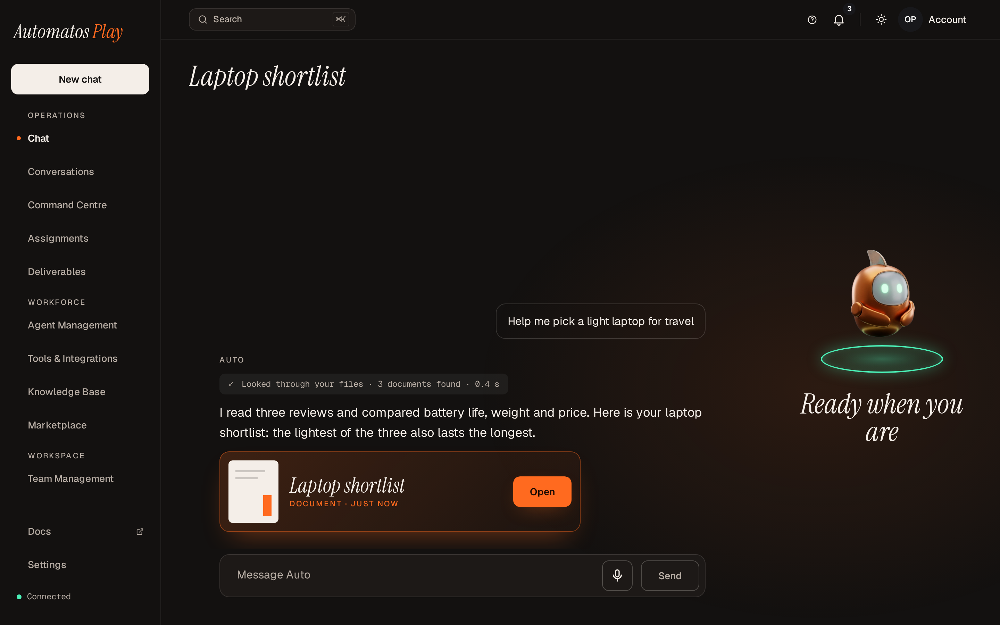

# Themes

A theme changes how Automatos looks for you in a workspace. It can give the app its own frame, its own versions of some pages, pages of its own, its own colours, fonts and mascot, and a set of looks you can tune. Your choice is yours alone: other members of the workspace pick their own.

<figure><figcaption>
Automatos with Play, a theme installed in the workspace, on its Ember look.
</figcaption></figure>

## Styles and themes

| Name | What it is |
| --- | --- |
| **Studio** | A style built into Automatos. It is the default: you see it until you, or your workspace, choose something else. |
| **Classic** | The other style built into Automatos. |
| **An installed theme** | A theme package (a .autotheme file) added to the workspace, from the Marketplace or from a file. No theme is built into the app: every theme, Play and HUD included, is installed this way. |
| **Play** and **HUD** | Two themes made in the [Automatos Design Kit](https://github.com/AutomatosAI/automatos-design-kit), under the publisher name reserved for Automatos. A workspace has them only once someone installs them. See [Play and HUD](#play-and-hud) below and [Get Play or HUD](installing-and-choosing.md#get-play-or-hud). |


**Studio** here is the name of a style. It is not Automatos Studio, the hosted app.


Each installed theme is built on one of the two styles, Studio or Classic: its base. This release of Automatos runs only themes built on Studio. A theme built on Classic installs and can be chosen, but it doesn't start: you see Studio, with the reason "Its theme.json could not be read." If a theme's version is withdrawn, you see its base in its place.

## Play and HUD

The current versions are **Play 1.2.1** and **HUD 1.1.1**.

- **Both talk.** Hold the voice button in their chat to talk to Auto, or hold the Space bar on a laptop or desktop. Where your workspace has Auto Live, the same button starts a live call. See [Voice Chat](../chat/voice.md).
- **Both fit a phone.** In a phone's browser, Play and HUD draw a layout of their own for a phone's width. See [On Your Phone](on-your-phone.md).



Play is Automatos with Auto the mascot.

<figure><figcaption>
Play on a laptop, Ember look.
</figcaption></figure>

<figure><figcaption>
Play in a phone's browser.
</figcaption></figure>



HUD is Automatos as a command deck.

<figure><figcaption>
HUD on a laptop, Arc look.
</figcaption></figure>

<figure><figcaption>
HUD in a phone's browser.
</figcaption></figure>



## Themes and looks

- A **theme** is the package: its code, its styles and its rules for looks.
- A **look** is one set of a theme's settings, such as its ground, accent or type, saved under a name.
- A theme ships **presets**: looks of its own that you can't change. You can save your own looks next to them.
- Your looks are kept on the server for you, per workspace and per theme. Classic and Studio have no looks.

[Full guide →](looks.md)

## Who vouches for a theme

Every installed theme sits in one of these groups. The group decides whether you must opt in before it runs, and whether it can be the workspace default.

| Kind | Where it comes from | Label you see | Each member opts in | Can be the workspace default |
| --- | --- | --- | --- | --- |
| **Private upload** | An owner or admin uploads a .autotheme file with **Install theme**. Nobody at Automatos reviewed it. | **Private · not reviewed**. The Appearance menu and ⌘K note **Private · opt in first** until you opt in. | Yes, once per version | No |
| **Signed upload** | An uploaded .autotheme file with its signature file (.sig.json), verified by an active Automatos signing key. | **Signed by Automatos**, in Settings, the Appearance menu and ⌘K | No | Yes |
| **Marketplace theme** | Added from **Marketplace → Themes**. A person at Automatos reviewed every version listed there. | None, or **Signed by Automatos** when its version is signed | No | Yes |
| **Official** | A Marketplace theme from the publisher name reserved for Automatos, whose listed version carries a signature an active Automatos key verifies. The reserved name alone never makes a theme Official. | **Official** on the Marketplace card, **Signed by Automatos** in Settings | No | Yes |


**Automatos's theme-signing key now ships with Automatos.** An official version is one Automatos reviewed and signed with that key: it shows **Signed by Automatos**, members don't opt in to it, and it can be the workspace default. In **Marketplace → Themes**, a signed Play or HUD version is marked **Official**.

**No release is signed yet.** The Design Kit's releases, Play 1.2.1 and HUD 1.1.1 included, carry no signature file so far. Until the first signed release, every theme you upload is a private upload, and every theme from **Marketplace → Themes** is a Marketplace theme. A signature file that the key didn't make is refused: "No Automatos signing key verifies this signature for these files, so nothing was installed."


Why the opt-in: a theme's code runs in your browser with your session. The opt-in dialog says so in the server's own words: "This theme was not reviewed. Its code runs with your access to all your workspaces." See [Opting in to a private theme](installing-and-choosing.md#opting-in-to-a-private-theme).

## Where everything is

The **Appearance** menu is the button with a sun, moon or screen icon (it shows your light or dark setting) at the top of the app, next to the notifications bell. A theme's own frame shows the same button among its header buttons.

| To do this | Go here |
| --- | --- |
| Get Play or HUD | [Get Play or HUD](installing-and-choosing.md#get-play-or-hud) |
| Switch between Classic, Studio and the installed themes | The **Appearance** menu, under **Style** |
| Switch by name | ⌘K (Ctrl+K), then the **Themes** group. Type "theme", "style" or "appearance" to list them all. |
| See the installed themes, opt in and choose one | **Settings → Appearance → Themes** |
| Install, update, roll back, uninstall, set the default, change the theme settings | **Settings → Appearance → Themes**, as an owner or admin |
| Browse the reviewed themes and add one | **Marketplace → Themes** |
| Edit your look | **Appearance → Customise look…**, which opens **Make it yours** |
| Get back in when a theme breaks the app | [Safe mode](managing-themes.md#safe-mode) |
| Pair a phone | **Settings → Phones & devices** |


Each theme names the narrowest window it draws in. Play 1.2.1 and HUD 1.1.1 draw from 360 pixels, a phone's width; another theme may need a wider window, such as 1024 pixels. In a window narrower than the theme's, you get Studio's layout instead, and **Make it yours** says it needs a wider window. **Customise look…** shows in the Appearance menu only while a theme is your style and its layout is showing.


## The two editions

| | Local edition | Hosted edition (Automatos Studio) |
| --- | --- | --- |
| Private uploads | On by default. | On by default only in a workspace of one person. An owner or admin can switch them on, unless the platform has turned them off. See [the workspace's theme settings](managing-themes.md#the-workspaces-theme-settings). |
| "Confirm it's you" | Never asked. | Sensitive theme actions ask you to confirm your sign-in when you last signed in more than 10 minutes ago (the server's default). |
| Withdrawn themes | The server checks Automatos's public list of withdrawn theme versions every hour by default. | Automatos keeps the list. |

The actions that ask you to confirm it's you: installing a theme (from a file or the Marketplace), opting in, making or clearing the default, applying an update, rolling back, changing the theme settings and publishing a theme. Choosing a theme and uninstalling one never ask.

## Pages in this section



Getting Play or HUD, **Install theme**, the scan report, opting in, choosing a theme, the workspace default and the signature file.

[Full guide →](installing-and-choosing.md)



Presets, **Make it yours**, saving, resetting, deleting and sharing a look, where your looks are kept, light, dark and reduced motion.

[Full guide →](looks.md)



For owners and admins: updates, pinned versions, roll back, uninstall, **Needs update**, withdrawn themes, when a theme fails, safe mode and the workspace's theme settings.

[Full guide →](managing-themes.md)



Play and HUD in a phone's browser, and what the server keeps for Automatos Go: your choice, your looks and each theme's phone skin.

[Full guide →](on-your-phone.md)



Themes are built with the open-source Automatos Design Kit.

[Full guide →](building-your-own.md)



The questions people ask first, with short answers.

[Full guide →](faq.md)


