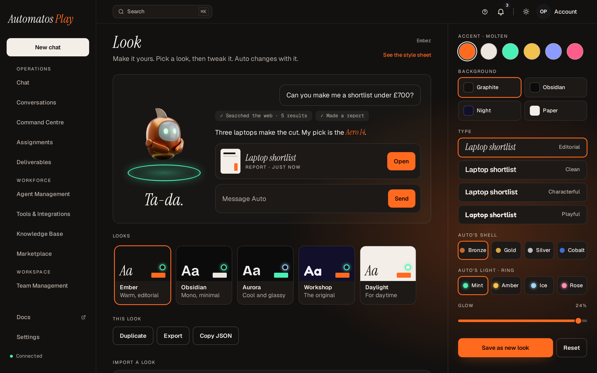
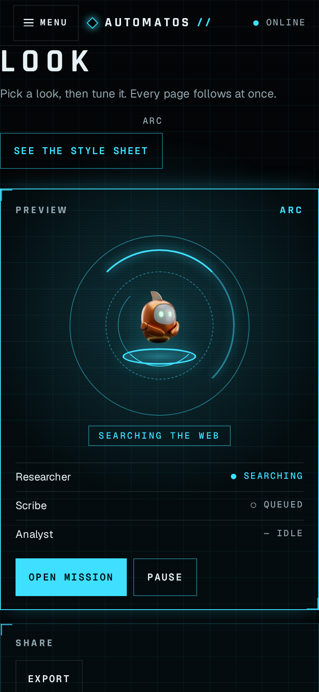

# Looks

A look is one way a theme can look: a set of its settings, saved under a name. Change the look and the whole app follows at once. Looks belong to a theme. Classic and Studio have none.

<figure><figcaption>
Play's look page, on the Ember preset. The preview follows each change.
</figcaption></figure>

## Presets, the default look and your own looks

| Kind | What it is |
| --- | --- |
| **Settings** | What a look is made of. The theme decides which ones it has, such as a ground, an accent, a typeface or a glow. |
| **Presets** | Looks that ship with the theme. You can pick one and tune it, but you can't change, rename or delete the preset itself: "A preset can't be changed. Save it as a new look instead." |
| **The default look** | The preset the theme names as its default. You see it until you pick or save a look of your own, and again after you delete the look you were on. |
| **Your looks** | Looks you saved. You can keep up to 100 per theme. |

## Where you edit a look

1. Open the **Appearance** menu: the sun, moon or screen button at the top of the app, next to the notifications bell.
2. Click **Customise look…**. It opens **Make it yours**.


**Customise look…** shows only while a theme is your style and its layout is showing, in a window at least as wide as the theme needs. Play 1.2.1 and HUD 1.1.1 draw from a phone's width.


The theme draws **Make it yours** itself. When there is nothing to edit, the page says why:

| You see | Why |
| --- | --- |
| "This style has no look to edit. Choose a theme with looks in the Appearance menu to make it yours." | Your style is Classic, Studio or a theme without a look page. |
| "No theme is installed in this workspace yet. A workspace owner or admin can add one from Marketplace › Themes; then choose it in the Appearance menu to make it yours." | The workspace has no theme to choose. |
| "It opens on a laptop or desktop screen: this theme's pages need a wider window." | The window is narrower than the theme needs. |

A theme can also have a **Style sheet** page of its own, which shows the theme's styles on your active look.

### What a look page can do

Automatos gives every theme the same set of look actions. The theme decides which buttons it shows and what they are called.

| Action | What happens |
| --- | --- |
| Change a setting | The active look changes at once, everywhere in the app. Each change is checked against the theme's rules first. |
| Save | Keeps the look among your looks. |
| Rename | Renames one of your looks. |
| Delete | Removes one of your looks. Deleting the look you are on takes you back to the theme's default look. |
| Export | Gives the look as a .look.json file. |
| Import | Takes a .look.json file or pasted text. It must pass the theme's checks, and it gets a fresh id. A file of 1 MB or more is refused before it is read. |

### Play and HUD

Their look pages are part of each theme, in the [Design Kit](https://github.com/AutomatosAI/automatos-design-kit):



**Make it yours** has:

- an editor with **Save as new look** and **Reset** (back to the picked look's saved values);
- **This look**, with **Save**, **Rename**, **Duplicate** and **Delete** for one of your looks (a preset can only be duplicated), **Export** and **Copy JSON**;
- **Import a look**: paste a look's JSON, or choose a .json file.



**Look** has the look drawer beside a live preview:

- the looks row, with its presets and your looks;
- the settings, **Save as new look**, **Reset** and **Delete** (for one of your own looks; it asks first);
- **Share**, with **Export** and **Import** (paste a look's JSON).

<figure><figcaption>
HUD's Look page in a phone's browser, on the Arc look.
</figcaption></figure>



## Where your looks are kept

- **On the server, for you.** One record per member, per workspace and per theme. Other members never see your looks, and your looks in another workspace are separate.
- **By theme, not by version.** An update, a roll back, an uninstall and a later install of the same theme all keep your looks.
- **With a copy in your browser.** The page paints at once from the copy, and the theme keeps working on it when the server can't be reached. A change goes to the copy at once and to the server once you pause. A change the server never got is sent on the next load. Other tabs follow through the copy.
- **Merged once.** The first time a browser meets the server's copy, any looks only that browser kept join the server's.
- **When looks can't be kept** (the browser blocks site storage, or the server refused them), a theme's look page can say so. Play and HUD do.

Looks are kept only for a theme installed in the workspace. For any other theme the server answers "This theme isn't installed in this workspace."

### After a theme update

A new version may change the theme's settings. Your looks are carried over each time they are read:

- a setting the new version dropped is left out;
- a setting it added, or a value it no longer accepts, takes that setting's default;
- a look that still doesn't fit is left out, and if it was your active look you get the theme's default look.


Reading never rewrites what is stored, so rolling back finds your looks as you saved them.


## Light, dark and motion

- **Tone.** A theme can let its look decide light or dark. The Appearance menu's tone items then rest, with "Set by your look". A theme that always uses one tone shows "Set by your theme". Otherwise the tone is yours.
- **Reduced motion.** When your device or browser asks for reduced motion, Automatos tells the theme, so its styles can stop loops and transitions. What a theme does with that is up to the theme.

Your looks are kept on the server, so a phone can read the same records: see [On Your Phone](on-your-phone.md).

To design a theme's settings and presets, see the Design Kit's [looks guide](https://github.com/AutomatosAI/automatos-design-kit/blob/main/guides/looks.md).
